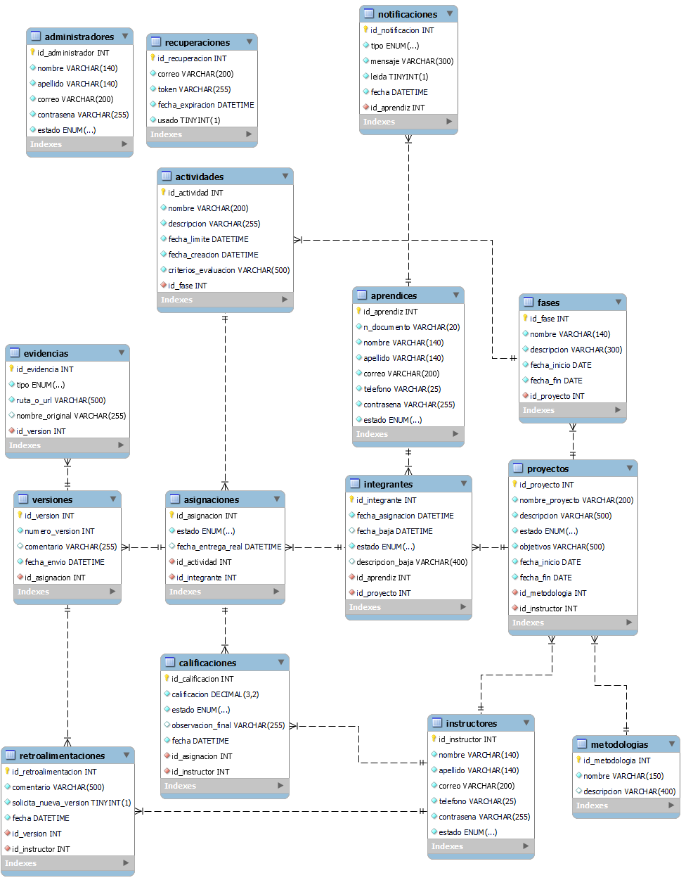

# FormaTIC

Plataforma web para la gestión y el seguimiento de proyectos formativos, que conecta a instructores y aprendices en un solo lugar.

> **Estado:** en desarrollo. Análisis y diseño de datos completados; construcción del sistema en curso.

## El problema

Los instructores lideres de fichas gestionan varios proyectos formativos a la vez y no cuentan con una herramienta centralizada para asignar actividades, revisar avances y dar retroalimentación. Esto dificulta la planificación, la trazabilidad y la calidad del proceso formativo.

## La solución

FormaTIC permite registrar proyectos organizados por fases, asignar actividades a los integrantes, recibir entregas con su historial de versiones, calificar, retroalimentar y generar reportes de avance, todo desde el navegador y con acceso según el rol de cada usuario.

## Funcionalidades previstas

| Rol | Qué podrá hacer |
|---|---|
| Aprendiz | Consultar proyectos y actividades, subir avances y nuevas versiones, ver retroalimentación y calificaciones |
| Instructor | Crear proyectos, fases y actividades, asignar aprendices, evaluar y retroalimentar, generar reportes |
| Administrador | Gestionar el sistema y sus usuarios |

## Estado actual

- [x] Especificación de requisitos (SRS, IEEE 830)
- [x] Matriz de actores
- [x] Modelo entidad-relación (15 tablas, MySQL)
- [x] Maquetación de la landing page (HTML y CSS)
- [ ] Autenticación con roles
- [ ] Gestión de proyectos, fases y actividades
- [ ] Entregas, versiones, evidencias y calificaciones
- [ ] Reportes y notificaciones

## Tecnologías

Previstas según el SRS: HTML, CSS, JavaScript y Python con Flask, con MySQL como base de datos.

## Modelo de datos

Decisiones de diseño principales:

- **Las entregas conservan su historial.** Cada reentrega crea una versión nueva en lugar de sobrescribir la anterior, y la retroalimentación se asocia a una versión concreta.
- **Las actividades se asignan a integrantes del proyecto**, no directamente a aprendices, para que solo quienes pertenecen al proyecto reciban actividades.
- **El estado de la entrega vive en la asignación**, porque una misma actividad la cursan varios aprendices y cada uno avanza a su ritmo.
- **Las evidencias guardan una ruta o enlace**, no el archivo dentro de la base de datos.

## Documentación

- Especificación de requisitos de software (SRS)
- Matriz de actores
- Modelo de datos (archivo de MySQL Workbench y PNG)

## Equipo

Proyecto formativo desarrollado por estudiantes de Tecnología en Análisis y Desarrollo de Software:

- Juan Munera
- Santiago Miranda
- Daniels Escaray
- Ernesto Amaya

## Licencia

Por definir.

## Aclaración

Este es un proyecto académico con fines formativos.
